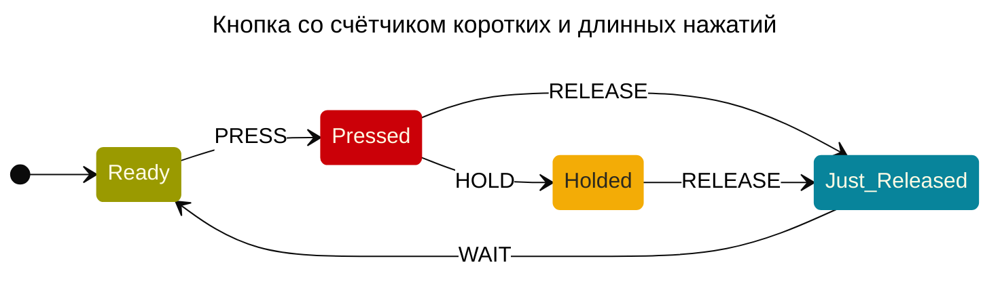

Youtube-запись от `2026-10-16`: https://youtu.be/5-TwZpA9JBw

# Рисуем-описываем конечные автоматы
80% кода — всё более и более детальная алгорифмическая реализация конечных автоматов.  
Но как насчёт записать сами конечные автоматы? И сначала довести до ума именно их.

- Ключевая статья 1987 года "[Statecharts: a visual formalism for complex systems](https://www.sciencedirect.com/science/article/pii/0167642387900359)" (PDF-версия бесплатна)

- "[Practical UML Statecharts in C/C++](https://www.state-machine.com/psicc2)", Miro Samek, 2008 — *бесплатно*

- «[Введение в теорию автоматов, языков и вычислений](https://www.williamspublishing.com/Books/978-5-8459-1969-4.html)», Джон Хопкрофт, Раджив Мотвани, Джеффри Ульман, 2018

- до чёрта всего старого и нового на Озоне или что там ещё шевелится

### Умных книжек много — а делать что?

#### 1 • Сформулировать суть поведения
Например, «Кнопка со счётчиком коротких и длинных нажатий».

#### 2 • Перечислить события
Что может натворить человек?  
**PRESS** — нажать  
**HOLD** — удерживать  
**RELEASE** — отпустить  
**WAIT** — подождать

#### 3 • Перечислить состояния
В конце каждого события должно быть какое-то состояние. Начнём с них.

**PRESS** → `PRESSED` — только что нажата  
**HOLD** → `HOLDED` — удерживается  
**RELEASE** → `JUST RELEASED` — только что отпущена  
**WAIT** → `READY` — готова к нажатию

Могут ли у нас быть другие состояния?  
То есть те, в которые **не попасть**?

Таким может быть только одно состояние — стартовое.  
Очевидно, ооооочень служебное. Допустим, `*`

#### 4 • Прописать все цепочки переходов между состояниями
Переходим из состояния к состоянию, ~~не теряя энтузиазма~~.  
Размножаем цепочки: «А это откуда может пойти?».

`READY` → **PRESS** → `PRESSED`

`PRESSED` → **HOLD** → `HOLDED`

`PRESSED` → **RELEASE** → `JUST RELEASED`

`HOLDED` → **RELEASE** → `JUST RELEASED`

`JUST RELEASED` → **WAIT** → `READY`

`*` → `READY` (надо же с чего-то начать)

> [!TIP]
> **Давайте, что ли, картинку какую нарисуем?**  
> А то много букв и явные повторы.  
> Тут и пригодится [Mermaid](https://mermaid.js.org/syntax/stateDiagram.html).




[Mermaid State Diagram](https://mermaid.js.org/syntax/stateDiagram.html)  
Всюду есть: GitHub, VSCode, Obsidian,…  
Но это просто картиночка.  
**А пошевелить?**

### Действительно, а как пошевелить?
Хватит писать статичные буквы.  
Возьмём инструмент, который оживит нашу схемку.

[Stately Sketch](https://sketch.stately.ai) — превращает Mermaid-схему… во что?  
Во что-то шевелящееся.  


Но вот что обидно — нам **явно** что-то недодали:  


Как же так, мы хотим контекста! А нету.

Что за контекст? Да хоть бы счётчики нажатий, почему нет.

> [!TIP]
> **Пришло время другой нотации**  
> Точно хотим, чтобы были переменные и действия с ними.  
> Нам поможет [XState v5](https://stately.ai/docs/xstate).

Давайте автоматом преобразуем Mermaid State Diagram в XState v5:
```bash
uvx --from "git+https://github.com/vgmakeev/xstate-mermaid.git" xstate-dsl mermaid2xstate mermaid.md -o xstate.json
```

Воспользовались? Не забудьте кинуть звезду на [репозиторий](https://github.com/vgmakeev/xstate-mermaid).

> И сразу, сразу для любителей всё скармливать LLM'е в надежде на чудо: не надо чудо, надо [Stately MCP](https://stately.ai/docs/packages/mcp).

### Добавим динамичности

Вот что мы имеем: 
```json
{
  "setup": {},
  "config": {
    "id": "unnamed",
    "initial": "Ready",
    "states": {
      "Ready": {
        "on": {
          "PRESS": "Pressed"
        }
      },
      "Pressed": {
        "on": {
          "HOLD": "Holded",
          "RELEASE": "Just_Released"
        }
      },
      "Holded": {
        "on": {
          "RELEASE": "Just_Released"
        }
      },
      "Just_Released": {
        "on": {
          "WAIT": "Ready"
        }
      }
    }
  }
}
```

Читать и писать такое — мало радости.  
**И оно даже не работает!**  


Но сейчас заработает. Сейчас-сейчас.  
Нужно только убрать лишнее и оставить только содержание `config`

ОК, то же самое получили.

Добавим счётчик.

> [!TIP]
> **Обернём одну нотацию в другую**  
> Придётся кодить.  
> Обернём наше описание автомата в функцию, которая будет его оживлять.  
> Базовый язык — JavaScript. А точнее, JavaScript API для [XState](https://stately.ai/docs/xstate).

Сначала просто обернём:

```js
import { setup, assign } from 'xstate';

const buttonMachine = createMachine({
  id: 'button',
  initial: 'Ready',

  context: {
    count: 0
  },

  states: {…}
});
```

И осталось научить счётчик меняться:

```js
Ready: {
      on: {
        PRESS: {
          target: 'Pressed',
          actions: assign({
            count: ({ context }) => context.count + 1
          })
        }
      }
    },

```

Ух ты!  


> [!WARNING]
> **Человечество не подписалось**  
> Это частный формат отдельно взятого проекта.  
> И даже компании.  
> В общем, за него не дают плюсиков на собеседовании.

